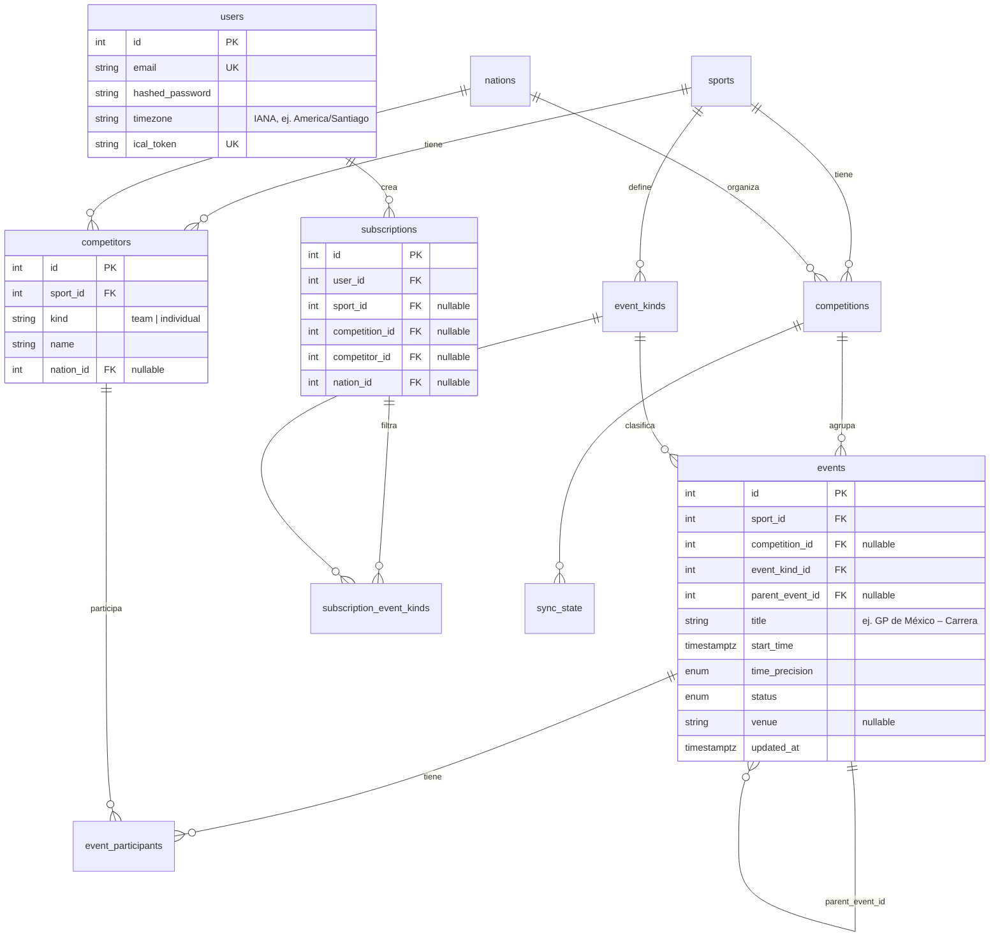

# Sports Calendar — Documento de diseño

> Estado: **borrador** · Última actualización: 2026-10-21

Este documento describe qué construimos, por qué y cómo. Las decisiones puntuales
se registran como ADRs en [`docs/adr/`](adr/).

---

## 1. Problema y objetivo

Seguir varios deportes a la vez hace fácil perderse partidos o competiciones.
Sports Calendar permite que cada usuario defina **suscripciones** (por ejemplo,
*Fútbol – FC Barcelona – Champions League* o *Tenis – Novak Djokovic*) y obtenga
un **calendario personalizado** con todos los eventos que coinciden, visible en la
web, en la app móvil y en su calendario habitual (Google / Apple) vía feed iCal.

## 2. Requisitos

### 2.1 Funcionales

| ID | Requisito |
|---|---|
| RF-1 | El usuario se registra e inicia sesión. |
| RF-2 | El usuario crea, lista y elimina **suscripciones**. Cada una combina uno o más filtros (deporte, competición, equipo, jugador, nación) que se unen con **Y**. Ejemplo: *equipo = Barcelona* **y** *competición = Champions*. |
| RF-3 | El calendario del usuario contiene los eventos que cumplen **al menos una** de sus suscripciones (las suscripciones se unen con **O**). |
| RF-4 | Cada evento muestra **fecha, hora** (en la zona horaria del usuario), participantes y competición. |
| RF-5 | Solo aparecen eventos **confirmados**. En los torneos por eliminación (tenis, playoffs) se muestra el próximo partido de un participante recién cuando está definido: si Djokovic gana su primer partido en Shanghái, el siguiente aparece cuando se conozca la fecha y la hora. |
| RF-6 | Los eventos que se postergan o cancelan se actualizan o se marcan; no quedan con datos viejos. |
| RF-7 | El usuario obtiene una **URL iCal privada** para suscribirse desde Google Calendar o Apple Calendar, y puede regenerarla. |
| RF-8 | Al crear una suscripción nueva, sus eventos aparecen sin esperar a la sincronización diaria (ver RNF-2). |

### 2.2 No funcionales

| ID | Requisito | Objetivo |
|---|---|---|
| RNF-1 | **Frescura de los datos** | Sincronización **diaria** de las competiciones que sigue al menos un usuario. |
| RNF-2 | **Sincronización al suscribirse** | Si la competición nunca se sincronizó, o lleva más de 24 h sin sincronizar, se lanza una tarea en segundo plano. Si se sincronizó hace poco, no se repite, para no gastar cuota. |
| RNF-3 | **Presupuesto de cuota** | No pasar el límite gratuito de cada fuente (≈100 req/día en API-Sports, 10 req/min en football-data). La ingesta lleva la cuenta de lo que consume. |
| RNF-4 | **Escala objetivo** | 1000 usuarios con la infraestructura mínima (ver §6), y un camino claro para crecer 100 veces sin rediseñar. |
| RNF-5 | **Rendimiento** | Calendario web y feed iCal en p95 < 300 ms. |
| RNF-6 | **Extensibilidad** | Agregar un deporte o una fuente nueva = escribir un adaptador nuevo, sin cambiar la API ni el modelo central. |
| RNF-7 | **Seguridad** | Contraseñas con hash, secretos solo en variables de entorno, token iCal largo y aleatorio que se puede revocar. |
| RNF-8 | **Calidad** | CI con lint y tests en cada PR; los tests de la base de datos corren contra PostgreSQL real. |

### 2.3 Fuera de alcance (por ahora)

- Resultados, marcadores y estadísticas. El modelo no debe impedir agregarlos después.
- Resultados en vivo y notificaciones push.
- Eventos creados por el usuario (está previsto, pero en una fase posterior).
- Funciones sociales.

### 2.4 Alcance del MVP

**Fútbol + Fórmula 1.** Son los deportes con las mejores fuentes (football-data.org
y Jolpica) y cubren los dos tipos de suscripción más comunes: por **equipo**
(Barcelona en la Champions) y por **competición** (toda la F1).

### 2.5 Implicaciones de diseño

1. **La hora de un evento no siempre es exacta.** En tenis la programación suele
   decir *"no antes de las 14:00"* o *"a continuación de"*, y en fútbol la fecha
   de una jornada a veces se confirma antes que la hora. El modelo necesita
   `start_time` + una **precisión** (`exact`, `not_before`, `date_only`).
   En iCal, un evento `date_only` se publica como evento de todo el día.
2. **Torneos por eliminación (RF-5).** No hace falta lógica especial: un partido
   aparece cuando la fuente lo publica con sus participantes confirmados. Basta
   con que el upsert por `external_id` actualice los eventos que ya tenemos.
3. **Frecuencia adaptativa (después del MVP).** Con sincronizar una vez al día
   puede pasar que el próximo partido de un tenista aparezca tarde. Más adelante
   se puede sincronizar más seguido los torneos en curso, gastando cuota solo
   donde importa.
4. **Sin resultados ⇒ sin `result_details`.** Se elimina del modelo (no hay que
   modelar lo que no se usa). Lo que sí se mantiene es `status`
   (`scheduled`, `postponed`, `cancelled`, `finished`), necesario para RF-6.

---

## 3. Fuentes de datos

### 3.1 Deportes en alcance

Fútbol, tenis, básquet, Fórmula 1, boxeo, MMA, NFL. La lista crecerá, así que la
arquitectura debe permitir **agregar un deporte o una fuente sin tocar el resto
del sistema** (ver §3.4).

### 3.2 Hallazgos de la investigación (oct 2026)

> ⚠️ Los planes gratuitos cambian seguido. Todo lo marcado como _"sin verificar"_
> se confirma con una cuenta y una llamada real antes de escribir el adaptador.

| Deporte | Candidata principal (gratis) | Alternativa | Observaciones |
|---|---|---|---|
| **Fútbol** | [football-data.org](https://www.football-data.org/pricing) — 12 competiciones gratis (incluye Champions, las 5 grandes ligas y el Mundial), 10 req/min | [API-Football](https://www.api-football.com/news/post/how-to-get-started-with-api-football-the-complete-beginners-guide) (API-Sports) — ~1200 ligas, 100 req/día | El plan gratuito de football-data entrega los datos con retraso; para un calendario no importa. Cobertura de temporadas de API-Football: _sin verificar_ |
| **F1** | [Jolpica-F1](https://docs.fastf1.dev/api_reference/jolpica.html) — sucesor de Ergast, abierto, 4 req/s y 500 req/h | API-Sports Formula-1 | Es la mejor situación de todas: abierta, estable y con muchos datos |
| **Básquet** | API-Basketball (API-Sports) — 100 req/día, NBA y ligas internacionales | API de ESPN no oficial | La de ESPN no tiene documentación ni términos de uso: solo como respaldo |
| **NFL** | API-American-Football (API-Sports) — 100 req/día | API de ESPN no oficial, [TheSportsDB](https://www.thesportsdb.com/pricing) | |
| **Tenis** | [Live Tennis API](https://duckdb.org/community_extensions/extensions/livetennis) — 100 req/día (_sin verificar_) | API-Tennis, scraping | Es el deporte más difícil de cubrir gratis. Hay que probar la calidad de los datos antes de decidir |
| **MMA** | [TheSportsDB](https://www.thesportsdb.com/season/4443-ufc/2026&view=1) — UFC, 30 req/min | API-Sports MMA, [UFCalendar](https://www.ufcalendar.com/developers/mma-api) (pago, ~USD 19/mes) | Otras promotoras (PFL, ONE) tienen menos cobertura gratis |
| **Boxeo** | ❌ No encontramos una API gratuita confiable | Scraping (revisar los términos de uso de cada sitio) | Candidato natural para el primer adaptador de scraping |
| **Respaldo general** | TheSportsDB — muchos deportes, plan gratuito con resultados limitados | [sporting-events.org](https://sporting-events.org/data/) — descargas CSV/JSON gratuitas, piden atribución | Útil para llenar huecos y para cargar el catálogo inicial |

### 3.3 Lo que la investigación implica para el diseño

1. **Ninguna fuente cubre todo.** Vamos a convivir con varias fuentes desde el día
   uno, así que el patrón *Adapter* (§3.4) no es opcional.
2. **Las cuotas son pequeñas (≈100 req/día por API).** La ingesta tiene que
   **cuidar ese presupuesto**:
   - Los calendarios cambian poco: alcanza con sincronizar 1 a 4 veces al día,
     y con más frecuencia solo cerca de la fecha del evento.
   - Pedir los partidos **por competición o temporada**, no uno por uno.
   - **Ingesta según demanda:** solo se sincronizan las competiciones que al menos
     un usuario sigue. Así el costo depende del catálogo seguido, no de la cantidad
     de usuarios.
3. **La misma entidad llega desde varias fuentes.** "FC Barcelona" en
   football-data y en API-Football tiene IDs distintos. Hace falta una tabla de
   mapeo `external_ids (entity_type, entity_id, source, external_id)` en vez de
   una sola columna `external_id`. Esto es **resolución de entidades**, y se
   empieza a mano: cuando dos fuentes no coinciden, se mapea manualmente.
4. **Prioridad entre fuentes.** Si dos fuentes traen el mismo evento, se define
   por deporte cuál manda (por ejemplo, football-data sobre API-Football para las
   12 competiciones que cubre).
5. **Licencias.** Para uso personal, el plan gratuito alcanza. Si la app se vuelve
   pública, el feed iCal **redistribuye** los datos, y hay que revisar los términos
   de cada fuente antes de abrirla al público.

### 3.4 Patrón de ingesta (borrador)

```
   ┌──────────────────────┐
   │ FootballDataProvider │──┐
   ├──────────────────────┤  │   fetch_events(competition, season)
   │ JolpicaF1Provider    │──┼──────────────────────────────────►  DTOs normalizados
   ├──────────────────────┤  │                                         │
   │ BoxingScraper        │──┘                                         ▼
   └──────────────────────┘                          resolución de entidades (external_ids)
                                                                       │
                                                                       ▼
                                                     upsert idempotente  →  PostgreSQL
```

Cada fuente implementa la misma interfaz (`EventProvider`). El resto del sistema
(API, calendario, iCal) **no sabe** de qué fuente vino cada evento.

---

## 4. Modelo de datos v2

### 4.1 Cambios respecto a v1

| v1 | v2 | Por qué |
|---|---|---|
| `teams` + `players` por separado; `event_participants` polimórfico (`participant_type` + `participant_id` sin FK) | Una sola tabla **`competitors`** (`kind = team \| individual`); `event_participants.competitor_id` con FK real | Integridad referencial; Barcelona, Djokovic, Verstappen y Red Bull son todos "quien compite". Una suscripción apunta a un solo `competitor_id` |
| — | **`event_kinds`** por deporte (F1: `practice`, `qualifying`, `sprint`, `race`; fútbol: `match`) + **`subscription_event_kinds`** | El usuario elige qué tipos de sesión quiere (RF-2, decisión F1 = opción *d*) |
| `result_details JSONB` | Se elimina | Fuera de alcance (§2.3) |
| `status` texto libre | Enum: `scheduled`, `postponed`, `cancelled`, `finished` | RF-6; un valor inválido no llega a la base de datos |
| — | `time_precision` (`exact`, `not_before`, `date_only`) | §2.5.1 |
| — | `parent_event_id` | Agrupar las sesiones de un Gran Premio (y más adelante las rondas de un torneo) |
| — | Tablas `*_external_refs` | Una entidad puede venir de varias fuentes (§3.3.3) |
| — | `sync_state` | Saber cuándo se sincronizó cada competición (RNF-1, RNF-2) |
| `users` sin zona horaria | `timezone`, `ical_token`, `created_at` | RF-4, RF-7 |

### 4.2 Diagrama entidad-relación



### 4.3 Semántica de las suscripciones

- **Dentro** de una suscripción, los filtros se combinan con **Y**:
  `competitor = Barcelona` **y** `competition = Champions`.
- **Entre** suscripciones se combinan con **O** (RF-3).
- `subscription_event_kinds` **vacío = todos los tipos**. La interfaz preselecciona
  los tipos por defecto del deporte (`event_kinds.is_default`; en F1:
  clasificación, sprint y carrera), así el usuario solo cambia lo que quiere.
- `nation_id`: eventos donde participa un competidor de esa nación (selecciones
  nacionales, tenistas de un país).

### 4.4 La consulta central

Todo el sistema (calendario web, app y feed iCal) depende de esta consulta, así
que hay que diseñarla y crear sus índices desde el principio:

```sql
SELECT DISTINCT e.*
FROM events e
JOIN subscriptions s ON s.user_id = :user_id
WHERE e.start_time BETWEEN :from AND :to
  AND (s.sport_id       IS NULL OR e.sport_id       = s.sport_id)
  AND (s.competition_id IS NULL OR e.competition_id = s.competition_id)
  AND (s.competitor_id  IS NULL OR EXISTS (
        SELECT 1 FROM event_participants p
        WHERE p.event_id = e.id AND p.competitor_id = s.competitor_id))
  AND (s.nation_id      IS NULL OR EXISTS (
        SELECT 1 FROM event_participants p JOIN competitors c ON c.id = p.competitor_id
        WHERE p.event_id = e.id AND c.nation_id = s.nation_id))
  AND (NOT EXISTS (SELECT 1 FROM subscription_event_kinds k WHERE k.subscription_id = s.id)
       OR e.event_kind_id IN (SELECT k.event_kind_id FROM subscription_event_kinds k
                              WHERE k.subscription_id = s.id));
```

Índices iniciales: `events (competition_id, start_time)`, `events (sport_id, start_time)`,
`event_participants (competitor_id, event_id)` y `subscriptions (user_id)`.
Cuando haya datos reales se valida con `EXPLAIN ANALYZE`, no a ojo.

### 4.5 Mapeo con fuentes externas

```
competition_external_refs (competition_id FK, source, external_id)  UNIQUE (source, external_id)
competitor_external_refs  (competitor_id  FK, source, external_id)  UNIQUE (source, external_id)
event_external_refs       (event_id       FK, source, external_id)  UNIQUE (source, external_id)
```

Usamos tres tablas con la misma forma en lugar de una sola `external_ids`
polimórfica: es la misma razón por la que eliminamos el `event_participants`
polimórfico, cada fila tiene una FK real. El `UNIQUE (source, external_id)`
es lo que hace **idempotente** el upsert de la ingesta.

## 5. Arquitectura

> _Pendiente._

## 6. Estimación de carga

> _Pendiente — incluir el cálculo para 1000 usuarios (< 1 req/s de iCal)._

## 7. Plan por fases

> _Pendiente._
