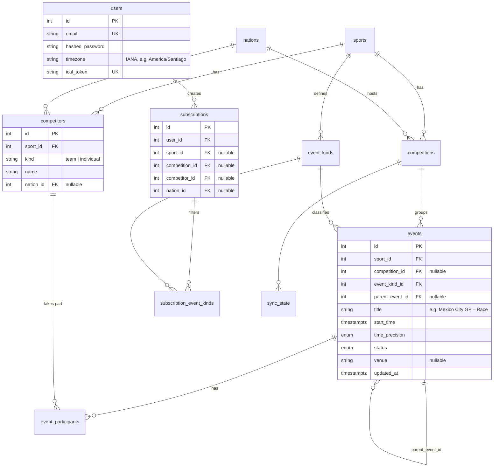
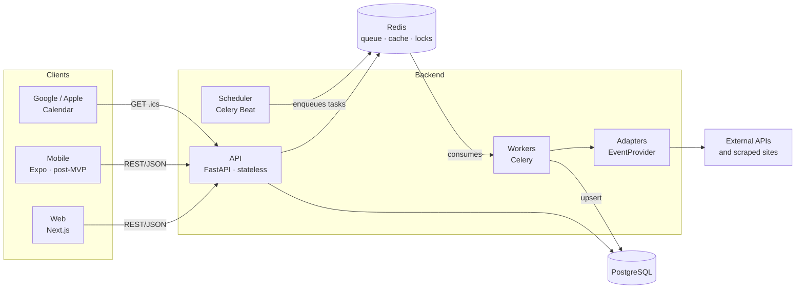

# Sports Calendar — Design Document

> Status: **draft** · Last updated: 2026-10-25

This document describes what we are building, why, and how. Individual decisions
are recorded as ADRs in [`docs/adr/`](adr/):

| ADR | Decision |
|---|---|
| [0001](adr/0001-monorepo.md) | Monorepo for backend, web and mobile |
| [0002](adr/0002-data-sources-and-adapters.md) | Multiple data sources behind a common interface |
| [0003](adr/0003-unified-competitors.md) | A single `competitors` table for teams and individuals |
| [0004](adr/0004-ical-feed.md) | iCal feed with a private token and TTL caching |
| [0005](adr/0005-string-enums-with-check-constraints.md) | Fixed-value columns as VARCHAR + CHECK, not native ENUM |

---

## 1. Problem and goal

Following several sports at once makes it easy to miss matches or competitions.
Sports Calendar lets each user define **subscriptions** (for example,
*Football – FC Barcelona – Champions League* or *Tennis – Novak Djokovic*) and get
a **personalized calendar** with every matching event, available on the web, in the
mobile app, and in their usual calendar (Google / Apple) through an iCal feed.

## 2. Requirements

### 2.1 Functional

| ID | Requirement |
|---|---|
| FR-1 | Users can sign up and log in. |
| FR-2 | Users can create, list and delete **subscriptions**. Each one combines one or more filters (sport, competition, team, player, nation) joined with **AND**. Example: *team = Barcelona* **and** *competition = Champions League*. |
| FR-3 | A user's calendar contains the events that match **at least one** of their subscriptions (subscriptions are joined with **OR**). |
| FR-4 | Each event shows its **date and time** (in the user's time zone), participants and competition. |
| FR-5 | Only **confirmed** events are shown. In knockout tournaments (tennis, playoffs), a participant's next match appears only once it is set: if Djokovic wins his first match in Shanghai, the next one appears when its date and time are known. |
| FR-6 | Postponed or cancelled events are updated or flagged; they never keep stale data. |
| FR-7 | Users get a **private iCal URL** to subscribe from Google Calendar or Apple Calendar, and can regenerate it. |
| FR-8 | When a user creates a new subscription, its events appear without waiting for the daily sync (see NFR-2). |

### 2.2 Non-functional

| ID | Requirement | Target |
|---|---|---|
| NFR-1 | **Data freshness** | **Daily** sync of every competition followed by at least one user. |
| NFR-2 | **Sync on subscribe** | If the competition has never been synced, or was last synced more than 24 h ago, a background task is queued. If it was synced recently, it is skipped to save quota. |
| NFR-3 | **Quota budget** | Never exceed each source's free limit (≈100 req/day on API-Sports, 10 req/min on football-data). Ingestion tracks its own usage. |
| NFR-4 | **Target scale** | 1,000 users on minimal infrastructure (see §6), with a clear path to 100× growth without a redesign. |
| NFR-5 | **Performance** | Web calendar and iCal feed at p95 < 300 ms. |
| NFR-6 | **Extensibility** | Adding a sport or a source = writing a new adapter, without changing the API or the core model. |
| NFR-7 | **Security** | Hashed passwords, secrets only in environment variables, long random iCal token that can be revoked. |
| NFR-8 | **Quality** | CI with lint and tests on every PR; database tests run against a real PostgreSQL. |

### 2.3 Out of scope (for now)

- Results, scores and statistics. The model must not prevent adding them later.
- Live scores and push notifications.
- User-created events (planned, but for a later phase).
- Social features.

### 2.4 MVP scope

**Football + Formula 1.** These sports have the best sources (football-data.org
and Jolpica) and cover the two most common subscription types: by **team**
(Barcelona in the Champions League) and by **competition** (all of F1).

### 2.5 Design implications

1. **An event's time is not always exact.** Tennis schedules often say
   *"not before 2:00 pm"* or *"followed by"*, and in football a matchday's date is
   sometimes confirmed before its kick-off time. The model needs `start_time` plus
   a **precision** (`exact`, `not_before`, `date_only`). In iCal, a `date_only`
   event is published as an all-day event.
2. **Knockout tournaments (FR-5).** No special logic is needed: a match appears
   when the source publishes it with confirmed participants. The upsert by
   external ID only has to update the events we already have.
3. **Adaptive frequency (post-MVP).** With a single daily sync, a tennis player's
   next match may show up late. Later on, in-progress tournaments can be synced
   more often, spending quota only where it matters.
4. **No results ⇒ no `result_details`.** It is removed from the model (don't
   model what isn't used). `status` stays (`scheduled`, `postponed`, `cancelled`,
   `finished`), since FR-6 needs it.

---

## 3. Data sources

### 3.1 Sports in scope

Football, tennis, basketball, Formula 1, boxing, MMA, NFL. The list will grow, so
the architecture must allow **adding a sport or a source without touching the rest
of the system** (see §3.4).

### 3.2 Research findings (Oct 2026)

> ⚠️ Free plans change often. Anything marked _"unverified"_ is confirmed with an
> account and a real request before writing its adapter.

| Sport | Main candidate (free) | Alternative | Notes |
|---|---|---|---|
| **Football** | [football-data.org](https://www.football-data.org/pricing) — 12 free competitions (Champions League, the top 5 leagues and the World Cup), 10 req/min | [API-Football](https://www.api-football.com/news/post/how-to-get-started-with-api-football-the-complete-beginners-guide) (API-Sports) — ~1,200 leagues, 100 req/day | football-data's free plan delays the data, which doesn't matter for a calendar. API-Football's season coverage: _unverified_ |
| **F1** | [Jolpica-F1](https://docs.fastf1.dev/api_reference/jolpica.html) — Ergast's successor, open, 4 req/s and 500 req/h | API-Sports Formula-1 | The best situation of all: open, stable and data-rich |
| **Basketball** | API-Basketball (API-Sports) — 100 req/day, NBA and international leagues | Unofficial ESPN API | ESPN's API has no documentation or terms of use: fallback only |
| **NFL** | API-American-Football (API-Sports) — 100 req/day | Unofficial ESPN API, [TheSportsDB](https://www.thesportsdb.com/pricing) | |
| **Tennis** | [Live Tennis API](https://duckdb.org/community_extensions/extensions/livetennis) — 100 req/day (_unverified_) | API-Tennis, scraping | The hardest sport to cover for free. Data quality must be tested before deciding |
| **MMA** | [TheSportsDB](https://www.thesportsdb.com/season/4443-ufc/2026&view=1) — UFC, 30 req/min | API-Sports MMA, [UFCalendar](https://www.ufcalendar.com/developers/mma-api) (paid, ~USD 19/month) | Other promotions (PFL, ONE) have less free coverage |
| **Boxing** | ❌ No reliable free API found | Scraping (check each site's terms of use) | Natural candidate for the first scraping adapter |
| **General fallback** | TheSportsDB — many sports, free plan with limited results | [sporting-events.org](https://sporting-events.org/data/) — free CSV/JSON downloads, attribution required | Useful to fill gaps and to load the initial catalog |

### 3.3 What the research means for the design

1. **No source covers everything.** We will live with several sources from day
   one, so the *Adapter* pattern (§3.4) is not optional.
2. **Quotas are small (≈100 req/day per API).** Ingestion has to **respect that
   budget**:
   - Schedules change rarely: syncing 1–4 times a day is enough, and more often
     only close to the event date.
   - Fetch matches **per competition or season**, not one by one.
   - **On-demand ingestion:** only competitions followed by at least one user are
     synced. Cost then depends on the followed catalog, not on the number of users.
3. **The same entity arrives from several sources.** "FC Barcelona" has different
   IDs in football-data and in API-Football, so a single `external_id` column is
   not enough: we need mapping tables (see §4.5). This is **entity resolution**,
   and it starts manual: when two sources disagree, the mapping is done by hand.
4. **Source priority.** If two sources return the same event, each sport defines
   which one wins (e.g. football-data over API-Football for the 12 competitions it
   covers).
5. **Licensing.** For personal use the free plans are enough. If the app goes
   public, the iCal feed **redistributes** the data, so each source's terms must be
   reviewed before opening it up.

### 3.4 Ingestion pattern (draft)

```
   ┌──────────────────────┐
   │ FootballDataProvider │──┐
   ├──────────────────────┤  │   fetch_events(competition, season)
   │ JolpicaF1Provider    │──┼──────────────────────────────────►  normalized DTOs
   ├──────────────────────┤  │                                         │
   │ BoxingScraper        │──┘                                         ▼
   └──────────────────────┘                            entity resolution (*_external_refs)
                                                                       │
                                                                       ▼
                                                     idempotent upsert  →  PostgreSQL
```

Every source implements the same interface (`EventProvider`). The rest of the
system (API, calendar, iCal) **doesn't know** which source an event came from.

---

## 4. Data model v2

### 4.1 Changes from v1

| v1 | v2 | Why |
|---|---|---|
| Separate `teams` + `players`; polymorphic `event_participants` (`participant_type` + `participant_id` with no FK) | A single **`competitors`** table (`kind = team \| individual`); `event_participants.competitor_id` is a real FK | Referential integrity; Barcelona, Djokovic, Verstappen and Red Bull are all "someone who competes". A subscription points at a single `competitor_id` |
| — | **`event_kinds`** per sport (F1: `practice`, `qualifying`, `sprint`, `race`; football: `match`) + **`subscription_event_kinds`** | Users choose which session types they want (FR-2) |
| `result_details JSONB` | Removed | Out of scope (§2.3) |
| Free-text `status` | Enum: `scheduled`, `postponed`, `cancelled`, `finished` | FR-6; an invalid value never reaches the database |
| — | `time_precision` (`exact`, `not_before`, `date_only`) | §2.5.1 |
| — | `parent_event_id` | Groups the sessions of a Grand Prix (and later the rounds of a tournament) |
| — | `*_external_refs` tables | An entity can come from several sources (§3.3.3) |
| — | `sync_state` | Tracks when each competition was last synced (NFR-1, NFR-2) |
| `users` without a time zone | `timezone`, `ical_token`, `created_at` | FR-4, FR-7 |

### 4.2 Entity-relationship diagram



### 4.3 Subscription semantics

- **Within** a subscription, filters are combined with **AND**:
  `competitor = Barcelona` **and** `competition = Champions League`.
- **Across** subscriptions they are combined with **OR** (FR-3).
- An **empty** `subscription_event_kinds` means **all kinds**. The UI preselects
  the sport's default kinds (`event_kinds.is_default`; for F1: qualifying, sprint
  and race), so users only change what they want.
- `nation_id`: events where a competitor from that nation takes part (national
  teams, a country's tennis players).

### 4.4 The core query

The whole system (web calendar, app and iCal feed) depends on this query, so it
has to be designed, and indexed, from the start:

```sql
SELECT e.*
FROM events e
WHERE e.start_time >= :start AND e.start_time < :end
  AND EXISTS (
    SELECT 1 FROM subscriptions s
    WHERE s.user_id = :user_id
      AND (s.sport_id       IS NULL OR s.sport_id       = e.sport_id)
      AND (s.competition_id IS NULL OR s.competition_id = e.competition_id)
      AND (s.competitor_id  IS NULL OR EXISTS (
            SELECT 1 FROM event_participants p
            WHERE p.event_id = e.id AND p.competitor_id = s.competitor_id))
      AND (s.nation_id      IS NULL OR EXISTS (
            SELECT 1 FROM event_participants p JOIN competitors c ON c.id = p.competitor_id
            WHERE p.event_id = e.id AND c.nation_id = s.nation_id))
      AND (NOT EXISTS (SELECT 1 FROM subscription_event_kinds k WHERE k.subscription_id = s.id)
           OR EXISTS (SELECT 1 FROM subscription_event_kinds k
                      WHERE k.subscription_id = s.id AND k.event_kind_id = e.event_kind_id)))
ORDER BY e.start_time;
```

`EXISTS` is a **semi-join**: an event matched by several subscriptions is returned once,
with no `DISTINCT` (an earlier draft used `JOIN subscriptions … SELECT DISTINCT`, which
builds every event × subscription pair and then deduplicates). The range is half-open
(`[start, end)`), so consecutive windows never overlap. Implemented in
`app/services/calendar.py`, with the semantics pinned down by `tests/test_calendar_query.py`.

Initial indexes: `events (competition_id, start_time)`, `events (sport_id, start_time)`,
`event_participants (competitor_id, event_id)` and `subscriptions (user_id)`.
Once there is real data they are validated with `EXPLAIN ANALYZE`, not by eye.

### 4.5 Mapping to external sources

```
competition_external_refs (competition_id FK, source, external_id)  UNIQUE (source, external_id)
competitor_external_refs  (competitor_id  FK, source, external_id)  UNIQUE (source, external_id)
event_external_refs       (event_id       FK, source, external_id)  UNIQUE (source, external_id)
```

We use three identically shaped tables instead of a single polymorphic
`external_ids` table, for the same reason we dropped the polymorphic
`event_participants`: every row has a real FK. The `UNIQUE (source, external_id)`
constraint is what makes the ingestion upsert **idempotent**.

### 4.6 Post-MVP extension: following players within a team

**Chosen semantics:** following a player = the events of **the teams they play for**
(club and national team), not just the matches where they are in the lineup.
Lineups are known ~1 h before kick-off and aren't included in free plans, so they
are useless for a calendar. The UI labels it *"Matches of Messi's teams"*.

```
competitor_memberships
  member_id   FK → competitors (kind = individual)
  team_id     FK → competitors (kind = team)
  valid_from  date
  valid_to    date NULL          -- NULL = current
```

This is a **temporal relationship**: a transfer closes one membership and opens
another, and existing subscriptions keep working unchanged. The core query
extends the competitor filter to *"the competitor takes part **or** a team they
belonged to on the event date takes part"*. The same mechanism covers tennis
doubles pairs and driver ↔ constructor in F1.

To do: verify which source provides squads and how much quota syncing them costs.

## 5. Architecture

### 5.1 Components



| Component | Responsibility | Why this way |
|---|---|---|
| **API** | Authentication, subscriptions, calendar, iCal feed | **Stateless**: scaling means adding instances behind a load balancer |
| **Workers** | Ingestion (call sources, normalize, upsert) | Separate from the API: a slow or failing source never affects users |
| **Scheduler** | Triggers the daily sync | A single process, so tasks are never enqueued twice |
| **PostgreSQL** | Source of truth | Relational data with strong constraints, exactly what the model needs |
| **Redis** | Celery queue, iCal feed cache, sync locks, quota counters | Already in the stack; covers four needs with one component |

### 5.2 Main flows

**A. Daily sync (NFR-1)**
1. Celery Beat enqueues `sync_followed_competitions` once a day.
2. The task finds competitions with **at least one subscriber**, direct or
   indirect (a followed team pulls in its competitions).
3. For each one it enqueues `sync_competition(competition_id)`.
4. `sync_competition` takes a **Redis lock** (`SET NX` with expiry). If another
   task is already syncing that competition, it exits without doing anything.
5. The adapter downloads the data, **normalizes** it into common DTOs, resolves
   entities through `*_external_refs` and **upserts** it.
6. It updates `sync_state.last_synced_at`.

**B. New subscription (FR-8, NFR-2)**
1. `POST /api/v1/subscriptions` stores the subscription and responds immediately.
2. If the competition involved has an empty `last_synced_at`, or one older than
   24 h, it enqueues `sync_competition`. The lock from step A.4 prevents duplicates.

**C. iCal feed (FR-7)**
1. `GET /calendar/{ical_token}.ics` looks up the user by token.
2. If there is a cached response in Redis (1 h TTL), it returns it.
3. Otherwise it runs the core query (§4.4), renders the `.ics` and caches it.

> **We use a TTL instead of cache invalidation.** Exact invalidation ("this change
> affects these users") is complex and error-prone. Since the data refreshes once a
> day and Google polls every few hours, one extra hour of delay matters to no one.
> It is a deliberate trade-off: simpler code in exchange for slightly less fresh data.

### 5.3 Quota control (NFR-3)

Each adapter declares its limit (e.g. `10/min` or `100/day`). Before each call, a
Redis counter per source and time window decides whether the call is allowed. If
there is no budget left, the task is **rescheduled** instead of failing.

### 5.4 Open decisions

- **Authentication:** in-house (short-lived JWT access token + refresh token) or
  an external provider. To be decided in an ADR at the start of the users phase.
- **Hosting:** to be decided in the deployment phase.

## 6. Load estimate

Assumptions for **1,000 users**:

| Item | Calculation | Result |
|---|---|---|
| iCal feed | 1,000 users × ~6 polls/day from Google or Apple | 6,000 req/day ≈ **0.07 req/s** |
| Web/app | 200 daily active × 20 req | 4,000 req/day ≈ **0.05 req/s** |
| Peak (10× the average) | | **~1–2 req/s** |
| Football events (12 competitions) | ~380 matches × 7 leagues + cups | **~4,000 events/season** |
| F1 events | 24 GPs × ~5 sessions | **~120 events/season** |
| football-data quota | 12 competitions × 1 sync/day | **12 req/day** (the limit is 10/min) |
| Jolpica quota | 1–2 req/day | Far below 500/h |

**Conclusion:** a small server with PostgreSQL handles this load with plenty of
headroom. The real risk **is not load but source quota**, and that depends on how
many competitions are followed, not on how many users there are.

**To grow 100× (100,000 users, ~100–200 req/s at peak)**, in this order and only
when the metrics call for it:
1. More API instances (it's stateless).
2. Serve the `.ics` files from a CDN or straight from Redis.
3. A PostgreSQL read replica for the core query.
4. More workers and, if needed, paid source plans.

## 7. Phased plan

| Phase | Content | Requirements |
|---|---|---|
| **0. Foundation** | Move CI to `.github/workflows/` with a PostgreSQL service; `pydantic-settings` and secrets in `.env`; `docker-compose` at the root; README; `CLAUDE.md`; pre-commit with Ruff | NFR-7, NFR-8 |
| **1. Design** | This document and the ADRs | — |
| **2. Model v2** | SQLAlchemy models and **a fresh initial migration** (there is no production data, so resetting the migration history is cleaner than chaining changes); catalog seed; the **core calendar query** (§4.4), so the model is validated against its real use | §4, FR-2, FR-3 |
| **3. Ingestion** | `EventProvider` interface; football-data and Jolpica adapters; `sync_state`, locks and quota; Celery Beat; tests with recorded responses (fixtures) | FR-5, FR-6, NFR-1–3, NFR-6 |
| **4. Users and calendar** | Authentication; subscription CRUD; calendar endpoint (exposes the query from phase 2); iCal feed; sync on subscribe | FR-1–4, FR-7, FR-8, NFR-5 |
| **5. Web** | Client generated from OpenAPI (`packages/api-client`); UI to create subscriptions and view the calendar | — |
| **6. Deployment** | Hosting, managed database, logs and metrics, alerts (e.g. "an adapter returned 0 events") | NFR-4 |
| **Post-MVP** | Following players (§4.6), tennis, basketball, NFL, MMA, boxing (scraping), mobile app, user-created events, adaptive frequency | — |
